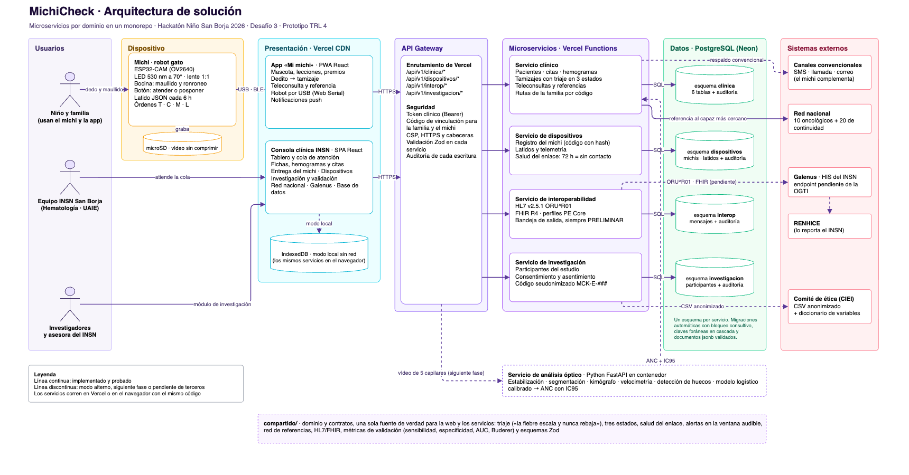
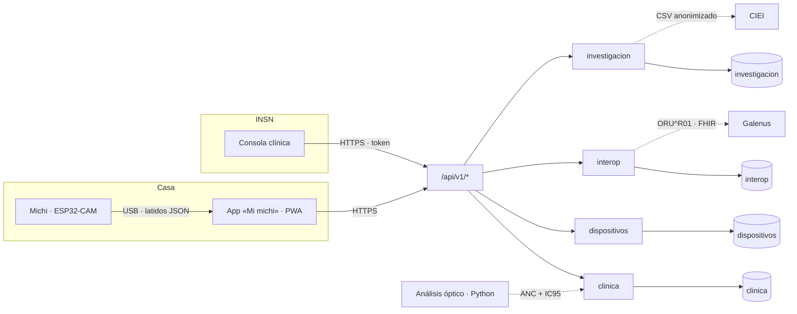

# MichiCheck

Sistema de acompañamiento para niños en tratamiento por leucemia linfoblástica
aguda. Consta de un robot con forma de gato que vive en casa del paciente, una
app que usa el niño con su familia, y una consola clínica para el equipo del
INSN San Borja.

Hackatón Niño San Borja 2026, Desafío 3 (Ruta Hematológica).

En vivo: **https://michicheck.vercel.app**

---

## El problema que atacamos

En la fase de mantenimiento el tratamiento dura unos dos años, es ambulatorio y
el niño se ve sano. Ahí es donde se concentra el abandono. Las familias que
viven lejos acumulan viajes, gasto y días de trabajo perdidos hasta que dejan de
ir. El hospital se entera cuando el paciente falta a una cita, y en
mantenimiento las citas son mensuales.

MichiCheck intenta dos cosas: que la familia tenga un motivo diario para no
desengancharse, y que el hospital reciba una señal antes de que se pierda una
cita.

---

## Arquitectura

Microservicios por dominio dentro de un monorepo. Cada servicio es una función
independiente en Vercel con su propio esquema en PostgreSQL, y todos comparten
un mismo paquete de dominio y contratos para que la web y el servidor nunca
calculen distinto.



El diagrama editable está en
[`arquitectura/michicheck-arquitectura.drawio`](arquitectura/michicheck-arquitectura.drawio):
se abre directo en [app.diagrams.net](https://app.diagrams.net) con
*Archivo → Abrir desde → Dispositivo*.



| Servicio | Ruta | Qué guarda | Qué resuelve |
|---|---|---|---|
| Clínico | `/api/v1/clinica` | pacientes, citas, hemogramas, tamizajes, teleconsultas, referencias | Triaje en tres estados, cola de atención, rutas de la familia por código de vinculación |
| Dispositivos | `/api/v1/dispositivos` | michis, latidos | Registro del robot, telemetría y salud del enlace (72 h sin latido = sin contacto) |
| Interoperabilidad | `/api/v1/interop` | mensajes | HL7 v2.5.1 ORU^R01 y FHIR R4 PE Core, siempre como resultado preliminar |
| Investigación | `/api/v1/investigacion` | participantes | Consentimiento, asentimiento y código seudonimizado para el estudio |
| Análisis óptico | Python, puerto 8000 | — | Del vídeo capilar al ANC con su intervalo de confianza |

Algunas decisiones que conviene conocer:

- **El servidor es la fuente de verdad.** El servicio clínico recalcula el
  triaje de cada tamizaje que recibe; lo que mande el cliente no se usa para
  decidir la conducta.
- **El mismo código corre en dos lugares.** Los servicios son clases que
  dependen de una interfaz de almacén. En Vercel usan PostgreSQL; en el
  navegador usan IndexedDB. Así la app funciona sin red y la demostración no
  depende de la conexión del auditorio.
- **Contratos con Zod** compartidos entre la web y los servicios. Una petición
  que no cumple el contrato se rechaza con el detalle del campo.
- **Seguridad por tipo de usuario.** El equipo clínico entra con un token
  Bearer. La familia y el michi solo con su código de vinculación, que se
  guarda como hash. Cada escritura queda en la tabla de auditoría de su esquema.

### Estructura

```
compartido/           Dominio, contratos Zod, almacenes, clientes HTTP y semilla
  dominio/            Óptica, triaje, estados, enlace, alertas, red, HL7/FHIR, métricas
  almacen/            Interfaz única: SQL (pg y PGlite), IndexedDB y memoria
servicios/            Un directorio por microservicio (servicio, rutas, esquema)
  analisis_optico/    API FastAPI del pipeline óptico
  plataforma/         HTTP, autenticación, conexión y migraciones
api/                  Una función de Vercel por servicio
web/                  React 19 + Vite: portada, consola (/insn) y app del niño (/michi)
src/michicheck/       Paquete Python: física, visión, modelo, triaje, interoperabilidad
firmware/             Firmware del ESP32-CAM con bocina
arquitectura/         Diagrama de solución en draw.io y PNG
scripts/              Base de datos, demo, dataset y figuras
tests/                Pruebas del paquete Python
```

---

## Correr el proyecto

Hace falta Node.js 22.22 o superior y Python 3.10 o superior.

```bash
npm ci
npm run dev
```

Eso abre la portada en `http://localhost:5173`, la consola en `/insn` y la app
del niño en `/michi/`. En desarrollo los cuatro microservicios corren dentro del
mismo servidor de Vite, en `/api/v1/*`.

Para revisar todo antes de subir cambios:

```bash
npm run verificar
```

Corre la verificación de tipos, el linter, las pruebas (dominio, servicios
sobre memoria y sobre PostgreSQL embebido, e interfaz) y la compilación de
producción.

El pipeline óptico en Python:

```bash
python -m venv .venv && source .venv/bin/activate
pip install -e '.[api,viz,dev]'
pytest -q
```

Y para levantar todo junto con el guion de la demo:

```bash
bash scripts/demo.sh
```

Ambas apps traen un recorrido guiado que se reproduce solo; se activa con el
botón DEMO o añadiendo `?demo=1` a la URL.

---

## Base de datos

La app tiene dos modos y se cambia entre ellos desde **Consola → Base de
datos**.

| Modo | Dónde viven los datos | Cuándo usarlo |
|---|---|---|
| Local | IndexedDB del navegador | Demostraciones, uso sin red, pruebas |
| Servidor | PostgreSQL detrás de los microservicios | Piloto con datos compartidos entre la consola y las familias |

Desde esa misma pantalla se descarga un respaldo en JSON, se restaura, se carga
la demostración, se migra lo local al servidor, se vacía la base, se recorren
los registros de cada colección y se ve el SQL de cada esquema.

### Variables de entorno

| Variable | Dónde | Para qué |
|---|---|---|
| `DATABASE_URL` | Servidor | Cadena de conexión de PostgreSQL. También se acepta `POSTGRES_URL` |
| `MICHICHECK_TOKEN` | Servidor | Token del equipo clínico, de 16 caracteres o más. Sin él las rutas clínicas responden 503 |
| `VITE_MODO_DATOS` | Compilación | `servidor` para que la app arranque en modo servidor; si no, arranca en local |

En local se ponen en `.env.local`, que está fuera del repositorio.

### Comandos

```bash
npm run db:migrar     # crea los cuatro esquemas y aplica las migraciones pendientes
npm run db:semilla    # vacía y carga los seis pacientes de demostración
npm run db:vaciar     # borra todos los datos y conserva las tablas
npx tsx scripts/db.ts sql   # imprime el DDL completo
```

Las migraciones también corren solas la primera vez que un servicio recibe una
petición, con un bloqueo consultivo para que dos funciones no las apliquen a la
vez.

---

## Conectar el robot

El michi se conecta por USB desde **Consola → Dispositivos** con Chrome o Edge
de escritorio (Web Serial, 115 200 baudios). El firmware manda cada latido como
una línea JSON:

```json
{"latido":1,"bateria_pct":82,"capturas_en_cola":0,"alertas_emitidas":4,"alertas_atendidas":3,"silenciamientos":0,"escalado":false,"firmware":"0.3.0"}
```

y acepta órdenes de una letra: `T` pide el dedito, `C` recuerda la cita, `M`
maúlla y `L` pide un latido. Cada latido recibido se guarda en el servicio de
dispositivos para la serie elegida. Si no hay robot a mano, el botón **Usar
simulador** emite latidos cada ocho segundos.

El servicio de dispositivos ya acepta que el michi publique sus latidos por
HTTPS con su serie y el código de vinculación en la cabecera `x-michi-codigo`;
el firmware actual todavía los entrega por USB.

---

## Los tres estados

El tamizaje no devuelve solo un número. Devuelve uno de tres estados, cada uno
con su plazo y su responsable.

| Estado | Cuándo | Conducta | Plazo |
|---|---|---|---|
| Estable | Límite inferior del IC95 por encima de 500/µL, sin fiebre | Recordatorio de audio | — |
| Grave | El IC95 baja de 500/µL, el tamizaje no concluye, o el michi lleva 3 días callado | Teleconsulta con el médico asignado | 6 h |
| Priorizable | Fiebre ≥ 38 °C con neutropenia, o tamizaje dudoso con fiebre | Teleconsulta + opción de ingreso por emergencia | 15 min |

Hay una regla que atraviesa todo el triaje: la fiebre escala y nunca rebaja. Un
tamizaje dudoso puede aumentar la conducta que indica la clínica, nunca
reducirla. Con eso el modo de fallo grave (decirle a una familia que todo está
bien cuando el niño tiene neutropenia febril) queda descartado por diseño, y la
clase de seguridad del software baja de C a B según IEC 62304.

---

## El silencio del robot

El michi manda un latido cada seis horas. Si deja de mandarlo por más de 72
horas, el caso entra a la cola clínica como grave aunque el último tamizaje
haya salido normal.

La lógica es simple: no sabemos cómo está ese niño y llevamos días sin saberlo.
Y a diferencia de la cita perdida, esta señal llega en tres días y no en cuatro
semanas.

También se cuentan los silenciamientos. Si la familia apaga el robot tres veces
seguidas sin hacer el tamizaje, el michi deja de insistir y avisa al instituto.

---

## Cuando la familia no puede viajar a Lima

La red cargada tiene 10 centros oncológicos pediátricos (que están solo en
Lima, La Libertad, Arequipa y Cusco) y 20 hospitales regionales que pueden
hacer hemograma, hemocultivo, antibiótico de amplio espectro, transfusión y
hospitalización pediátrica.

Cuando la teleconsulta concluye que hace falta atención presencial, el sistema
busca el establecimiento capaz más cercano al domicilio y emite la referencia
declarando qué cosas ese establecimiento no puede hacer.

Un ejemplo de cómo se comporta: una niña de Bagua con fiebre no se manda nueve
horas a Trujillo por un hemocultivo. Se manda a Chachapoyas, con la advertencia
de iniciar el antibiótico antes del traslado. La primera hora manda sobre la
distancia. Si el motivo fuera quimioterapia, sí iría a Trujillo, porque eso no
se puede hacer en Chachapoyas.

---

## Cómo funciona el tamizaje

Con luz verde de 530 nm los glóbulos rojos absorben y el capilar del lecho
ungueal se ve oscuro. Un leucocito no lleva hemoglobina, deja pasar la luz y
produce un hueco que se puede contar.

```
R = C · v · π(d/2)² · 60 · 10⁻⁹
```

`R` son huecos por capilar por minuto, `C` la concentración celular, `v` la
velocidad del flujo y `d` el diámetro del capilar. El modelo reproduce el valor
publicado: 32 huecos/min dan 3 773 células/µL, y el paper reporta 3 773.

Después se aplica la fracción de neutrófilos por edad. Esto último importa más
de lo que parece: el umbral publicado de 7 huecos/min es de adultos, y aplicado
a un niño de dos años la alerta recién saltaría con un ANC de 272. El valor que
exige actuar es 500.

### Sobre el modelo

La física sola ya da AUC 0.943 sin entrenar nada. El modelo entrenado da 0.939,
o sea que no la supera. Está ahí por otras dos razones: corrige el sesgo de la
estimación física, que subestima por un factor de tres, y entrega una
probabilidad calibrada, sin la cual no se puede fijar un punto de operación.
Elegimos una regresión logística de cuatro variables porque gradient boosting
daba lo mismo y no es auditable.

La cohorte de entrenamiento es simulada, n=300. Es la limitación más grande que
tenemos. La validación real son vídeos con hemograma pareado, y eso pasa por el
comité de ética del instituto.

### Lo que no hace

No identifica células. No mide plaquetas, y no es cuestión de mejorar el
algoritmo: miden 2–4 µm y no ocluyen un capilar de 10–20 µm, así que el
fenómeno no ocurre. No mide hemoglobina. No reemplaza el hemograma. Todas las
salidas lo dicen, y en HL7 el resultado va marcado como preliminar con el método
explícito para que nadie lo confunda dentro de seis meses.

---

## Investigación y validación

**Consola → Investigación** acompaña la ruta de continuidad del INSNSB: reunión
inicial, proyecto de investigación con asesor, presentación al instituto,
aprobación y ejecución.

- **Participantes.** Registro con consentimiento del apoderado, asentimiento del
  niño y un código seudonimizado `MCK-E-###` que es lo único que sale del
  instituto.
- **Desempeño frente al hemograma.** Empareja cada hemograma con el tamizaje
  más cercano dentro de 24 horas y calcula sensibilidad, especificidad, VPP y
  VPN con intervalos de Wilson, el AUC, F1 y la concordancia de Bland-Altman
  en escala logarítmica.
- **Tamaño de muestra.** Fórmula de Buderer con la prevalencia, la sensibilidad
  esperada y la precisión que se fijen con la asesora.
- **Conjunto anonimizado.** CSV con diccionario de variables para el comité de
  ética, sin nombres ni historias clínicas y protegido contra inyección de
  fórmulas al abrirse en Excel.

Con los datos de demostración el punto de operación clasifica bien a los casos
con neutropenia, pero la especificidad es baja. Esa conversación (punto de
corte, muestra y si el IC95 debe anclarse a la fracción de neutrófilos del
último hemograma del paciente) es la que hay que tener con la asesora antes de
cerrar el protocolo.

---

## Integración con Galenus

Cada tamizaje sale como mensaje HL7 v2.5.1 ORU^R01 y como Bundle FHIR R4 con los
perfiles nacionales del MINSA. Ambos van con estado preliminar y el recuento en
`/uL` (UCUM). La correlación con el paciente se hace por historia clínica, que
queda enlazada con la serie del dispositivo en el primer control, cuando el
médico entrega el robot. Un michi corresponde a un paciente durante todo el
tratamiento, así que no hace falta emparejar por nombre ni por fecha de
nacimiento.

Lo que falta no es desarrollo. Falta el endpoint, las credenciales y el ambiente
de pruebas de la OGTI del instituto.

---

## Despliegue

Vercel compila la web con `npm run build`, publica `dist/` en su CDN y crea una
función por cada archivo de `api/`. La configuración está en `vercel.json`.

```bash
vercel login
vercel deploy --prod
```

Para el modo servidor:

1. En el proyecto de Vercel, **Storage → Marketplace → Neon** (PostgreSQL). Al
   conectarlo, Vercel agrega `DATABASE_URL` sola.
2. En **Settings → Environment Variables**, agregar `MICHICHECK_TOKEN` (por
   ejemplo con `openssl rand -hex 24`) y `VITE_MODO_DATOS=servidor`.
3. Volver a desplegar. Los esquemas se crean en la primera petición, o antes
   con `npm run db:migrar` apuntando a la misma `DATABASE_URL`.
4. En la consola, **Base de datos → Origen de los datos**, pegar el token.

Sin base de datos el despliegue sigue funcionando en modo local.

---

## Estado

Funciona y está probado: el modelo físico, el pipeline de visión, el
clasificador, los tres estados, el planificador de alertas, el estado del
dispositivo, la red de referencias, los cuatro microservicios con PostgreSQL,
la app del niño, la consola clínica, la conexión con el robot por USB, el
módulo de investigación, el firmware y la generación de HL7 y FHIR.

Falta: validación clínica con pacientes reales, la aprobación del proyecto por
el comité de ética, confirmación de los códigos RENIPRESS, el acuerdo de
interoperabilidad con la OGTI, y la firma de un médico en el protocolo clínico.

---

## Aviso

MichiCheck es un tamizaje. Orienta y prioriza, no diagnostica ni descarta, y no
debe usarse para modificar o suspender quimioterapia. La conducta clínica la fija
el protocolo y el profesional tratante.

Los pacientes que aparecen en las interfaces son ficticios.

Código bajo Apache-2.0.
